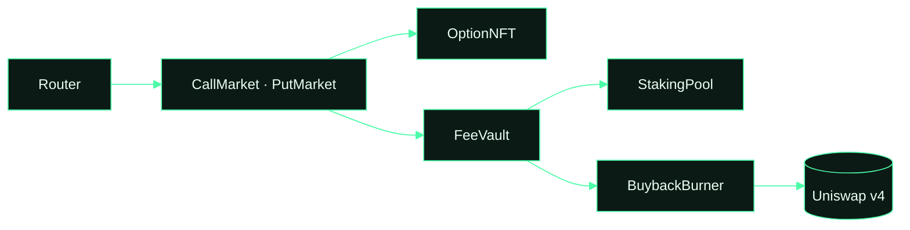

# kyte-abis

ABIs, addresses and TypeScript types for every Kyte contract on Robinhood Chain. Use it to read offers, build
transactions or index events without copying anything from the app.

```bash
npm install github:usekyte/kyte-abis
```

```ts
import { abis, addresses, chainId } from 'kyte-abis'
import { createPublicClient, http } from 'viem'

const client = createPublicClient({ transport: http('https://rpc.mainnet.chain.robinhood.com') })
const open = await client.readContract({
  address: addresses.v3.callMarket,
  abi: abis.CallMarket,
  functionName: 'offer',
  args: [1n],
})
```

## What is here

| File | Contents |
|---|---|
| `abis/*.json` | One JSON ABI per contract, straight from the compiled artifacts |
| `addresses.json` | Every live address on chain id 4663, including the v2 and v3 market sets and listed tokens |
| `index.mjs`, `index.d.ts` | `abis`, `addresses`, `chainId`, typed with `as const` for viem and wagmi |

## What talks to what



## Events worth indexing

| Contract | Event | When |
|---|---|---|
| CallMarket / PutMarket | `OfferCreated`, `OptionBought`, `Exercised`, `Expired`, `OfferCancelled` | the option lifecycle |
| FeeVault | `FeesSplit` | once per epoch |
| BuybackBurner | `Burned` | every buyback |
| StakingPool | `Staked`, `Unstaked`, `Claimed` | staking activity |

## Live addresses

| Contract | Address |
|---|---|
| $KYTE token | [`0x072D88c2F31F568C0F4B8F613692eB489541Ed45`](https://robinhoodchain.blockscout.com/address/0x072D88c2F31F568C0F4B8F613692eB489541Ed45) |
| StakingPool | [`0xD7253a90fd43507F44cF0934F3D5d7432760d17f`](https://robinhoodchain.blockscout.com/address/0xD7253a90fd43507F44cF0934F3D5d7432760d17f) |
| BuybackBurner | [`0x8A9d128247D8c4512411CF9D0CdCAc5Acf86FB95`](https://robinhoodchain.blockscout.com/address/0x8A9d128247D8c4512411CF9D0CdCAc5Acf86FB95) |
| FeeVault | [`0x78c569A1137B78cB78F42c42B4B6C2b8F1E3dDef`](https://robinhoodchain.blockscout.com/address/0x78c569A1137B78cB78F42c42B4B6C2b8F1E3dDef) |
| Uniswap v4 swap adapter | [`0xFa17818515E946180b9767f9D9c40A09EE80dda6`](https://robinhoodchain.blockscout.com/address/0xFa17818515E946180b9767f9D9c40A09EE80dda6) |
| KyteHook (Uniswap v4) | [`0x77e52E93Aa0892b29a4527Af4f3a79F01cfa9044`](https://robinhoodchain.blockscout.com/address/0x77e52E93Aa0892b29a4527Af4f3a79F01cfa9044) |
| AssetRegistry (markets v2/v3) | [`0x02f571e10B9c7303EB7A6284A7137b146e18658D`](https://robinhoodchain.blockscout.com/address/0x02f571e10B9c7303EB7A6284A7137b146e18658D) |
| CallMarket (v3) | [`0xb6759D8893601BB7c1A032eC8ea40C856a6adf80`](https://robinhoodchain.blockscout.com/address/0xb6759D8893601BB7c1A032eC8ea40C856a6adf80) |
| PutMarket (v3) | [`0x2E2d5DfB4cf30d15688Cc2DDD30641c78DFfcb35`](https://robinhoodchain.blockscout.com/address/0x2E2d5DfB4cf30d15688Cc2DDD30641c78DFfcb35) |
| Router (v3) | [`0xdD76956667E6423bAC56d2EbF827a9b0d7dBDF68`](https://robinhoodchain.blockscout.com/address/0xdD76956667E6423bAC56d2EbF827a9b0d7dBDF68) |
| OptionNFT (v3) | [`0xE0CD21A7Ed37898A5ACdF7Dc68C52259Cd63308B`](https://robinhoodchain.blockscout.com/address/0xE0CD21A7Ed37898A5ACdF7Dc68C52259Cd63308B) |
| WETH | [`0x0Bd7D308f8E1639FAb988df18A8011f41EAcAD73`](https://robinhoodchain.blockscout.com/address/0x0Bd7D308f8E1639FAb988df18A8011f41EAcAD73) |
| Uniswap v4 PoolManager | [`0x8366a39CC670B4001A1121B8F6A443A643e40951`](https://robinhoodchain.blockscout.com/address/0x8366a39CC670B4001A1121B8F6A443A643e40951) |

Report vulnerabilities to contact@kyte.sh. Kyte is not affiliated with or endorsed by Robinhood.
